# Awesome Status Page & Incident Communication 📡🚨

<p align="center">
  
</p>

<p align="center">
  <a href="https://github.com/ishandutta2007/Awesome-Awesome-Awesome"></a><a href="https://discord.gg/jc4xtF58Ve"></a>
  <a href="https://github.com/ishandutta2007/Awesome-Status-Page-Incident-Communication/stargazers"></a>
  <a href="https://github.com/ishandutta2007/Awesome-Status-Page-Incident-Communication/network/members"></a>
  <a href="https://github.com/ishandutta2007/Awesome-Status-Page-Incident-Communication/blob/main/LICENSE"></a>
  <a href="https://github.com/ishandutta2007"></a>
</p>

---

## 🧭 Overview & Ecosystem Insights

Welcome to the definitive, SEO-optimized curated collection of **Status Page & Incident Communication** platforms. Whether managing critical mission-critical downtime, conducting scheduled maintenance, or automating multi-channel subscriber notifications (SMS, email, Webhooks, Slack, Teams), this directory indexes industry-leading **Enterprise SaaS solutions** alongside battle-tested **Self-Hosted Open-Source alternatives**.

---

## 📊 Sector Overview & Market Dynamics

The global **Incident Communication & Status Page** market—closely integrated with IT Incident Management and Digital Experience Monitoring—is estimated at **$1.8B to $2.4B** and is projected to expand at a **~14.5% CAGR**. 

The sector displays a **moderately fragmented yet converging structure**: category incumbents like Atlassian Statuspage maintain enterprise market share, but modern unified observability suites (Better Stack, Incident.io, FireHydrant) and developer-first static/edge platforms (Instatus, OpenStatus) are aggressively capturing mid-market and cloud-native workloads through automated ChatOps and developer ergonomics.

---

## 📑 Table of Contents
- [Sector Overview & Market Dynamics](#-sector-overview--market-dynamics)
- [Enterprise & Modern SaaS Platforms](#-enterprise--modern-saas-platforms)
- [Open-Source & Self-Hosted Status Pages](#-open-source--self-hosted-status-pages)
  - [Open-Source Comparison Table](#-open-source-comparison-table-sorted-by-github-stars)
  - [Deep-Dive & Architecture Summaries](#-open-source-deep-dive--architecture-summaries)
- [How to Choose the Right Tool](#-how-to-choose-the-right-tool)
- [Support](#-support)
- [Star History](#-star-history)
- [Contribution Guide](#-how-to-contribute)
- [Disclaimer & Best Practices](#-disclaimer--best-practices)

---

## ☁️ Enterprise & Modern SaaS Platforms

*Below is a comprehensive comparison of leading commercial status page and incident response suites, sorted descending by parent company scale (valuation / market capitalization / estimated ARR).*

| SaaS Product | Starting Pricing Tier | Free Tier / Trial Limit | Company Scale (Valuation / Scale) | Core Capabilities & Differentiators |
| :--- | :--- | :--- | :--- | :--- |
| **[Statuspage (Atlassian)](https://www.statuspage.io/)** | **$29/month** (Hobby plan) | **Free plan available**: 100 subscribers, 2 team members, 2 metrics, and basic incident communication | **~$48 Billion** *(Atlassian NASDAQ: TEAM market cap)* | The enterprise gold standard for public, private, and audience-specific status pages. Extensive third-party component integrations and multi-channel subscriber broadcasting. |
| **[Better Stack](https://betterstack.com/)** | **$29/month** (Freelancer / Uptime plan) | **Free plan available**: 10 monitors, 3-minute checks, 1 status page, unlimited email alerts | **~$500 Million** *(Latest private valuation / Series A)* | Combines uptime synthetic monitoring, on-call paging, log analytics, incident response, and status pages into one unified platform with SOC 2 & ISO 27001 compliance. |
| **[FireHydrant](https://firehydrant.com/)** | **$29/user/month** (Starter plan) | **30-day free trial** with full access to incident commander runbooks, integrations, and status pages | **~$300 Million** *(Total funding ~$38M+; Series B scale)* | End-to-end incident response orchestration featuring automated Slack/Teams incident commander channels, retrospective timelines, and public/internal status pages. |
| **[Incident.io](https://incident.io/)** | **$19/user/month** (Starter tier; min seats apply) | **14-day free trial** featuring full ChatOps workflows, automated incident response, and status catalog | **~$200 Million** *(Total funding ~$34M+; Series A/B scale)* | Slack-native and Teams-native engineering incident management platform with integrated public status pages, incident workflows, and AI post-mortems. |
| **[StatusCast](https://www.statuscast.com/)** | **$39/month** (Starter plan) | **14-day free trial** with full access to scheduled maintenance announcements, monitors, and employee paging | **~$30 Million - $50 Million** *(Bootstrapped profitable / Lower mid-market)* | Enterprise status communication focused on dual internal employee status portals and external customer incident communication with SSO and mass paging. |
| **[Status.io](https://status.io/)** | **$79/month** (Basic plan) | **7-day free trial** with access to multi-region infrastructure, custom domain, and subscriber alerts | **~$10 Million - $20 Million** *(Established bootstrapped market pioneer)* | Highly resilient architecture built completely independent of primary clouds; offers granular multi-cluster status components, custom HTML/CSS, and extensive webhooks. |
| **[Instatus](https://instatus.com/)** | **$20/month** (Pro plan, unlimited subs) | **Free plan available**: Unlimited subscribers, 3 team members, unlimited status updates, instatus.subdomain | **~$10 Million - $15 Million** *(Fast-growing indie SaaS / Seed scale)* | Ultra-fast CDN-backed status pages that load in milliseconds; affordable flat pricing without per-subscriber penalty pricing. |
| **[Hund](https://hund.io/)** | **$49/month** (Standard plan) | **14-day free trial** with full access to automated check watchers, custom domain, and multi-channel notices | **~$5 Million - $10 Million** *(Independent niche enterprise provider)* | Clean, no-nonsense automated status page with built-in health monitors, metric graphs, SSL tracking, and granular incident escalation policies. |
| **[Cachet (Cloud)](https://cachethq.io/)** | **$19/month** (Hosted Basic) | **14-day free trial** with fully hosted instance, custom domain, and email subscriber notifications | **~$3 Million - $6 Million** *(Commercial cloud arm of open-source Cachet)* | Fully hosted and managed distribution of Cachet, eliminating self-hosting overhead while delivering the classic dashboard-driven status experience. |
| **[StatusTicker](https://statusticker.com/)** | **$10/month** (Starter plan) | **14-day free trial** with up to 10 component checks, custom styling, and incident tracking | **~$1 Million - $3 Million** *(Micro-SaaS / Indie maker project)* | Lightweight, minimalist status communication platform targeted at indie hackers, agencies, and small SaaS businesses seeking instant setup. |

---

## 🛠️ Open-Source & Self-Hosted Status Pages

### 🌟 Open-Source Comparison Table (Sorted by GitHub_Stars)

| Open-Source Project | GitHub_Stars_Badge | License | Stack / Tech | Architectural Focus & Best Use Case |
| :--- | :--- | :--- | :--- | :--- |
| **[Uptime Kuma](https://github.com/louislam/uptime-kuma)** | [](https://github.com/louislam/uptime-kuma/stargazers) | MIT | Node.js, Vue, SQLite | Self-hosted monitoring Swiss Army knife with 30+ check types & customizable status pages. |
| **[Upptime](https://github.com/upptime/upptime)** | [](https://github.com/upptime/upptime/stargazers) | MIT | GitHub Actions, Git, Svelte | 100% serverless, zero-maintenance uptime monitor and static status page running directly via GitHub. |
| **[Cachet](https://github.com/cachethq/cachet)** | [](https://github.com/cachethq/cachet/stargazers) | BSD-3-Clause / Source-Available | PHP (Laravel), Blade | The pioneer open-source status page with components, incident management, metrics, and email subscribers. |
| **[Gatus](https://github.com/TwiN/gatus)** | [](https://github.com/TwiN/gatus/stargazers) | Apache-2.0 | Go, Pure CSS/JS | Ultra-lightweight declarative monitoring-as-code status dashboard configured via clean YAML files. |
| **[Healthchecks](https://github.com/healthchecks/healthchecks)** | [](https://github.com/healthchecks/healthchecks/stargazers) | BSD-3-Clause | Python, Django | Specialized cron job, daemon, and background task heartbeat monitoring with public/private status badges. |
| **[OpenStatus](https://github.com/openstatusHQ/openstatus)** | [](https://github.com/openstatusHQ/openstatus/stargazers) | AGPL-3.0 | Next.js, TypeScript, Go | Modern, distributed synthetic monitoring and incident status platform with multi-channel subscriber alerts. |
| **[OneUptime](https://github.com/OneUptime/oneuptime)** | [](https://github.com/OneUptime/oneuptime/stargazers) | Apache-2.0 | TypeScript, Node.js, Docker | Complete open-source DataDog & PagerDuty alternative featuring status pages, on-call, telemetry, and logs. |
| **[Statping](https://github.com/statping/statping)** | [](https://github.com/statping/statping/stargazers) | GPL-3.0 | Go, Vue.js | Classic self-hosted status page with mobile app support, charts, multi-database support, and offline alerts. |
| **[Kener](https://github.com/rajnandan1/kener)** | [](https://github.com/rajnandan1/kener/stargazers) | MIT | Node.js, SvelteKit, Tailwind | Modern status page with full incident management, 11 monitoring probes, recurring maintenance, and email alerts. |
| **[UptimeFlare](https://github.com/lyc8503/UptimeFlare)** | [](https://github.com/lyc8503/UptimeFlare/stargazers) | MIT | Cloudflare Workers, Pages | Serverless uptime monitoring and status page running globally on Cloudflare edge infrastructure for free. |
| **[Checkup](https://github.com/sourcegraph/checkup)** | [](https://github.com/sourcegraph/checkup/stargazers) | Apache-2.0 | Go | Distributed, lock-free self-hosted health check and status generator created by Sourcegraph. |
| **[cState](https://github.com/cstate/cstate)** | [](https://github.com/cstate/cstate/stargazers) | MIT | Hugo, Jamstack | Super-fast, serverless static incident status site driven by Markdown content and hosted on GitHub/Netlify/Vercel. |
| **[CF Workers Status Page](https://github.com/eidam/cf-workers-status-page)** | [](https://github.com/eidam/cf-workers-status-page/stargazers) | MIT | Cloudflare Workers, KV | Monitor website uptime and status history serverlessly on Cloudflare Workers edge with Telegram/Slack alerts. |
| **[Statusfy](https://github.com/juliomrqz/statusfy)** | [](https://github.com/juliomrqz/statusfy/stargazers) | Apache-2.0 | Nuxt.js, Vue.js, Markdown | Markdown-based status page engine with multi-language i18n, PWA support, and static site export. |
| **[Staytus](https://github.com/adamcooke/staytus)** | [](https://github.com/adamcooke/staytus/stargazers) | MIT | Ruby on Rails, MySQL | Elegant standalone web application to publish service status, incident timelines, and email notifications. |
| **[Statping-ng](https://github.com/statping-ng/statping-ng)** | [](https://github.com/statping-ng/statping-ng/stargazers) | GPL-3.0 | Go, Vue.js | Community-maintained fork of Statping fixing security issues, database drivers, and notification dispatch. |
| **[Vigil](https://github.com/valeriansaliou/vigil)** | [](https://github.com/valeriansaliou/vigil/stargazers) | MPL-2.0 | Rust | High-performance microservices status page and health monitoring server written in Rust with instant alerting. |
| **[TinyStatus](https://github.com/harsxv/tinystatus)** | [](https://github.com/harsxv/tinystatus/stargazers) | MIT | Python, Jinja2 | Ultra-minimalist single-file Python script generating an instant static status page dashboard. |
| **[LambStatus](https://github.com/ks888/LambStatus)** | [](https://github.com/ks888/LambStatus/stargazers) | Apache-2.0 | AWS Lambda, DynamoDB | Serverless status page system designed to run entirely within AWS free-tier compute with near-zero overhead. |

---

### 🔍 Open-Source Deep-Dive & Architecture Summaries

- **[Uptime Kuma](https://github.com/louislam/uptime-kuma)**: Single Docker container setup that features 30+ check probes (HTTP/HTTPS, TCP Port, Ping, DNS Record, Push Heartbeat, Steam Game Server, Docker Container status), customizable status pages on separate domains, and Telegram/Discord/Slack alerts. *Note: Incident posting is manual and email subscriber list management is not natively bundled.*
- **[Upptime](https://github.com/upptime/upptime)**: Uses GitHub Actions for scheduled uptime checks, GitHub Issues for incident tracking, and GitHub Pages for rendering a sleek Svelte status page. Zero servers, zero maintenance cost, though check frequency is bound by GitHub Actions schedule intervals (~5 min).
- **[OpenStatus](https://github.com/openstatusHQ/openstatus)**: Features automated incident generation from failing checks, beautiful Next.js UI, public REST API, and multi-channel notifications (Email, Webhook, Slack, Discord, RSS).
- **[Kener](https://github.com/rajnandan1/kener)**: Node.js/SvelteKit status page tool with multi-database persistence (SQLite/PostgreSQL/MySQL), scheduled maintenance rules (RRULE), 11 active probe types, and subscriber email broadcasting.
- **[Gatus](https://github.com/TwiN/gatus)**: Configuration-as-code status dashboard. Driven entirely by a clean YAML file without external database requirements; supports alerts to Slack, Discord, PagerDuty, and custom webhooks.
- **[OneUptime](https://github.com/OneUptime/oneuptime)**: Comprehensive open-source observability suite. Integrates status pages with telemetry (logs, metrics, traces), on-call scheduling, and automated workflows.

---

## 🎯 How to Choose the Right Tool

```
                                  [Need a Status Page?]
                                            |
                   ---------------------------------------------------
                   |                                                 |
         [Fully-Managed SaaS]                              [Self-Hosted / Open-Source]
                   |                                                 |
         -----------------------                           -----------------------
         |                     |                           |                     |
  [Status-Only Focus]   [Unified Suite]             [Monitoring-First]   [Communication-First]
  - Statuspage          - Better Stack              - Uptime Kuma        - Cachet
  - Instatus            - Incident.io               - Gatus              - Kener
  - Status.io           - FireHydrant               - Upptime            - OpenStatus
```

- **For Enterprise Compliance & High Subscriber Volume**: Choose **[Statuspage](https://www.statuspage.io/)** or **[Better Stack](https://betterstack.com/)**.
- **For Fast Setup & Zero Infrastructure**: Choose **[Upptime](https://github.com/upptime/upptime)** or **[UptimeFlare](https://github.com/lyc8503/UptimeFlare)**.
- **For Full Control with Subscriber Notifications**: Deploy **[OpenStatus](https://github.com/openstatusHQ/openstatus)** or **[Kener](https://github.com/rajnandan1/kener)**.
- **For Developer-Centric Homelabs & Internal Dashboards**: Run **[Uptime Kuma](https://github.com/louislam/uptime-kuma)** or **[Gatus](https://github.com/TwiN/gatus)**.

---

## 💖 Support

Thank you for visiting and using this curated ecosystem guide! If you found this repository helpful for evaluating status pages or incident management infrastructure, please consider supporting the project:

- ⭐ **Star this repository** to help others discover it.
- 🍴 **Fork and share** it with fellow SREs, DevOps engineers, and support leads.
- ☕ **Buy a coffee & sponsor**: You can support ongoing maintenance and new curated additions directly through the [GitHub Sponsor Dashboard](https://github.com/sponsors/ishandutta2007).

---

## 📈 Star History

[](https://star-history.dera.page/#ishandutta2007/Awesome-Status-Page-Incident-Communication&type=date&legend=top-left)

---

## 🤝 How to Contribute

Contributions are warmly encouraged! To submit a new tool or suggest updates:
1. Fork this repository 🍴
2. Create your feature branch (`git checkout -b feature/add-new-status-tool`)
3. Add your entry following the established table structure and include accurate pricing/star data 📝
4. Commit your changes (`git commit -m 'feat: add NewTool status platform'`)
5. Push to the branch (`git push origin feature/add-new-status-tool`)
6. Open a Pull Request with a clear description 🚀

---

## ⚠️ Disclaimer & Best Practices

> [!WARNING]
> **Independent Hosting Rule**: Never host your self-hosted status page on the exact same cloud cluster, VPC, or infrastructure provider that powers your production services. If your primary cloud region goes down, your status page must remain online to communicate with users.

> [!NOTE]
> Pricing tiers and repository metrics are actively audited. Commercial SaaS pricing and free tier terms are subject to change by respective vendors.

---

<p align="center">
  <sub>Maintained with ❤️ by <a href="https://github.com/ishandutta2007">Ishan Dutta</a> and community contributors worldwide.</sub>
</p>
